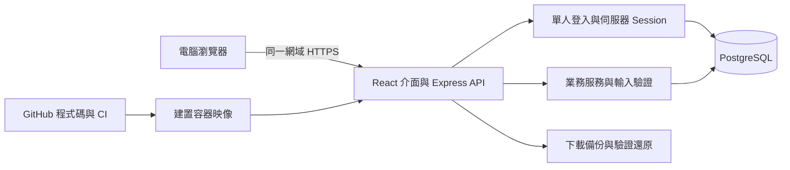

# 個人項目管理平台第一版開發規格

版本 1.0 · 2026年11月1日 · 時區 Asia/Hong_Kong

這是一份實作規格，供 VS Code 中具有讀檔、編輯和執行能力的開發助手使用。產品讓一個人集中處理七個生活領域，從收集事情、安排下一步，到記錄結果及跟進。交付是可登入、可保存資料、可部署的網頁應用；本文件不是已完成的軟件。

## 1 已確定的需求與實作決策

使用者已確定：自己使用、以電腦為主、涵蓋下列七領域，完成後部署上雲並將程式碼推送至個人 GitHub。介面預設繁體中文，香港時間，星期一為每週起點。GitHub 公開或私人、雲端供應商、網域及正式產品名稱尚未指定；這些不阻擋本機開發。暫名為「個人工作台」，repository 建議名為 personal-project-manager。

本規格選定：React、TypeScript、Vite 前端；Node.js、Express、PostgreSQL 後端；單一擁有者密碼登入；本機 Docker Compose 資料庫；部署時使用同一套 PostgreSQL 資料模型。這些是本版工程預設，不是使用者曾指定的框架。先前的本機 SQLite 構想由此取代，避免上雲時另做資料庫轉換。

DeepSeek 是開發助手，不是產品必須呼叫的服務。第一版不需要任何模型 API key，不應添加聊天助手或把個人內容送往模型服務。這份規格不假設特定模型版本、上下文長度或 VS Code 擴充套件功能。

## 2 第一版範圍

必須交付以下可操作流程：

- 單人登入、登出、工作階段到期。
- 快速收件箱、任務清單、每天最多三項重點、七領域及項目詳情。
- 今日／本週總覽、截止提醒、等待與跟進、統一日曆。
- 學業課程資料、申博申碩及兩地求職申請追蹤。
- 習慣打卡、簡單運動及睡眠紀錄。
- 聯絡人、互動紀錄、活動及文件連結。
- 搜尋、基本標籤／篩選、封存與恢復。
- 完整業務資料 JSON 匯出與經預覽確認的整體還原。
- 本機啟動、Docker 建置、雲端部署指南、GitHub CI 及必要測試。

本版不做多人協作、公開註冊、權限角色、自訂流程引擎、郵件或招聘網站抓取、代投遞、自動發信、外部日曆同步、背景推播、AI 排程、離線同步、原生手機程式、附件上傳、OCR、富文字編輯器、財務管理、健康診斷、關係評分、無限層級子任務。沒有這些功能時不要放可點擊的空殼入口。

## 3 系統架構與運行方式



開發時 Vite 使用 127.0.0.1:5173，Express 使用 127.0.0.1:3000；Vite 將 /api 代理至 Express。正式版由 Express 同時提供已建置前端與 /api，不要求跨網域 CORS。只提供 REST API，不引入 WebSocket、微服務、Redis 或任務佇列。

建議 Node.js 24 LTS。開發開始時查套件的 engine 與相容版本，鎖定實際使用版本，提交 package-lock.json 與 Node 版本檔；不得把浮動 latest 當重現環境。Vite 官方對 Node 有版本要求，Express 5 亦有自己的最低要求，應按實際安裝組合驗證。[Vite 文件](https://vite.dev/guide/)、[Node 發布狀態](https://nodejs.org/en/about/previous-releases)、[Express 文件](https://expressjs.com/en/5x/api/)

主要依賴用途：React Router 處理頁面；TanStack Query 處理伺服器資料與更新後快取；Zod 共用請求驗證；pg 連接資料庫；SQL migration 工具管理有版本的資料結構；express-session 與 connect-pg-simple 保存登入狀態；bcryptjs 驗證密碼雜湊；Vitest、Supertest、Playwright 驗證主要流程。CSS 使用統一 token 和 CSS Modules，避免引入多套 UI 系統。時間換算可使用 Luxon；date-only 必須保留字串／SQL DATE 語義。

pg 支援連線池及交易；Session 存在 PostgreSQL，不使用正式環境的記憶體 Session store。[pg 文件](https://node-postgres.com/)、[Session 文件](https://github.com/expressjs/session)、[PostgreSQL Session store](https://github.com/voxpelli/node-connect-pg-simple)

## 4 導航與頁面

左側固定導航依序為「總覽、收件箱、所有任務、日曆」，下方為七個領域；底部放「聯絡人、文件連結、搜尋、設定」。桌面主區域為可篩選清單及詳細頁；避免在首頁鋪滿七個大卡片及統計數字。

固定領域 ID 與名稱：

```text
study             學業 HKU-MAAIES
degree            申博申碩
career-hk         香港找工作／實習
internship-sz     深圳找實習
health            健康管理與運動
social            社交圈子管理
outreach          其他外展活動
```

領域不能刪除或新增；名稱不是資料關聯鍵。各領域沿用共用任務和項目頁，只在需要的地方加入專用區塊。

### 頁面與路由

- /login：密碼欄、登入按鈕及清楚的失敗／限流狀態。無註冊、忘記密碼或社交登入的空入口。
- /：今日重點、今日安排、未來七日截止、到期跟進；可切換本週。每區預設最多五筆並有「查看全部」。過期事項獨立呈現，不塞入今天已排定的工作。
- /inbox：未歸類的未完成任務，建立時只需標題。可直接選領域或項目、安排日期、完成或取消。
- /tasks：所有任務；依領域、項目、狀態、標籤、日期範圍篩選。提供「無日期」篩選，預設不隱藏無日期任務。以清單為主，首版不要求拖拉看板。
- /tasks/:id：任務完整編輯及關聯資料，刷新網址仍可到達。
- /areas/:areaId：領域概覽、項目、任務及相關活動。degree、career-hk、internship-sz 加入申請清單；health 加入習慣及紀錄；social 加入人物；outreach 以活動為主。
- /projects/:id：摘要、日期、狀態、任務、相關人物、活動、文件；依 kind 顯示課程或申請欄位。
- /calendar：月曆與本週議程，可依領域和項目類型篩選。從日期新增活動，點擊事項編輯原資料；首版不做拖動改期。
- /events/:id：活動詳情、報名及出席狀態、人物與項目關聯、筆記。
- /contacts 和 /contacts/:id：人物搜尋、關係標籤、互動時間線、約定及相關項目。
- /resources：文件連結、用途、版本名稱及關聯，可搜尋。
- /search?q=：跨任務、項目、申請機構／職位、聯絡人、活動和文件搜尋；結果顯示類型與領域，點擊進入原資料。
- /settings：登入說明、固定語言／時區、資料匯出、還原、各類封存資料。可從此恢復封存紀錄。

所有頁面必須有首次使用、載入中、空結果、錯誤、儲存中、成功、未儲存離開及 Session 到期狀態。首啟動只種入七領域，不混入虛構個人紀錄。示範資料只可由明確 demo 指令產生於獨立資料庫。

## 5 核心資料模型

以下是實作合約，可調整 SQL 欄位命名但不可改變語義。API 使用 camelCase，SQL 使用 snake_case。一般主鍵為 UUID；所有可編輯業務主表都有 created_at、updated_at、version 整數，支援封存的主表另有 archived_at。日期為 DATE，時間點為 TIMESTAMPTZ；輸出時間點為帶 Z 的 ISO 8601。TEXT 欄位不得直接當 HTML 執行。

### 領域與項目

- areas：id TEXT 主鍵、name、sort_order。只接受固定七個 ID。
- projects：id、primary_area_id、title、description、kind、status、due_on、due_at、due_timezone、next_step、tags TEXT[]。
- kind 為 general、course、degree_application、job_application。status 為 active、paused、completed、cancelled；封存另行處理。
- kind 建立後不可修改；course 的主領域固定為 study。通用項目更新不得將申請項目直接設為 completed/cancelled；未關閉申請只允許 active/paused，關閉或重開由申請服務處理。
- project_related_areas：project_id、area_id，複合主鍵。相關領域不能等於主領域；其他領域顯示為「相關項目」，全局只計一次。
- course_details：project_id 主鍵及外鍵、course_code、term、instructor_name。只有 course 使用。閱讀、作業、論文都用關聯任務／文件，不另建 LMS。

### 任務與每日重點

- tasks：id、title、description、project_id 可空、area_id 可空、status、priority、planned_on、due_on、due_at、due_timezone、follow_up_on、estimated_minutes 可空、completed_at 可空、tags TEXT[]、contact_id 可空、event_id 可空。
- status 為 todo、doing、waiting、done、cancelled；priority 為 low、normal、high，預設 normal。
- 新任務預設 todo。首次切入 done 時伺服器填 completed_at，重複保存 done 不刷新該時間；離開 done 時清空，cancelled 不填完成時間。
- 有 project_id 時 area_id 必須為空，領域即項目主領域；無項目時 area_id 可以直接選擇。兩者皆空的未完成任務出現在收件箱，不另造一個「收件箱狀態」。
- 修改項目主領域後，其任務即時顯示新領域。解除項目關聯時，在同一操作將原主領域轉成任務 area_id，避免無意掉回收件箱。
- daily_focus：local_date、task_id、position；主鍵為 date + task_id，另 UNIQUE(date, position)，position 僅 1至3。以交易處理同日新增／排序，第四件回傳 409。已完成的重點仍保留在該日，明天不自動複製。
- focus_days：local_date 主鍵、version；作該日重點清單的版本。未建立時 GET 回空陣列及 version=0；首次 PUT 比對0後建立 version=1，其後逐次增加。拒絕重複 taskId；只可新選未完成、未取消、未封存的任務。

### 申請

- applications：project_id 主鍵及外鍵、application_type（degree 或 job）、organization_name、role_or_program、degree_level 可空、work_type 可空、location、posting_url、portal_url、stage、outcome 可空、applied_on 可空、receipt_verified BOOLEAN、next_follow_up_on 可空、notes。
- degree_level 為 master 或 phd；work_type 為 full_time 或 internship。degree_application 必須在 degree；job_application 必須在 career-hk 或 internship-sz。深圳模組預設 internship。
- stage 為 exploring、preparing、submitted、assessment、interview、decision、closed；介面顯示中文。outcome 為 offered、accepted、rejected、withdrawn、declined、unknown，未有結果時為空。
- application_stage_history：id、project_id、from_stage 可空、to_stage、changed_at、note。變更階段與歷史新增同一交易完成。
- applied_on 只記實際提交日，不能把修改狀態的今天當成提交日。若日期未知可留空，介面顯示待補。
- receipt_verified 必須由使用者主動確認，預設 false。收藏、備妥材料、已提交、回執已核實是不同資訊。
- closed 需選結果：accepted、rejected、withdrawn、declined 或 unknown；offered 配合 decision。申請關閉時項目設 completed，withdrawn 設 cancelled；重新開啟則設 active。未關閉時可暫停項目。這個映射由申請服務統一執行。
- exploring 至 interview 的 outcome 必須空；decision 僅空或 offered；closed 只接受上述終局結果。從 closed 重開至前面的階段時清空 outcome，保留真實提交日、回執確認及歷史。規則同時用於新增、更新及備份驗證。
- 完成「提交申請」任務不自動改申請階段，改成 submitted 不自動完成項目；階段變動也不替使用者完成／取消其他任務。
- 申請清單預設顯示機構、職位／課程、階段、申請截止、提交日、下次跟進、下一步及回執標記。香港與深圳只是各自主領域的篩選入口。

### 活動與日曆

- events：id、title、description、primary_area_id、project_id 可空、kind、location、url、all_day、start_on、end_on、starts_at、ends_at、timezone、registration_status、registration_due_on、registration_due_at、registration_due_timezone、attendance_status、notes、tags TEXT[]。
- kind 為 class、interview、meeting、exercise、social、outreach、other。定時活動需 starts_at、ends_at、timezone；ends_at > starts_at，date 欄為空。
- 全天活動用 start_on、end_on，兩端日期均包含，end_on >= start_on；時間點欄為空。若日曆套件要求 exclusive end，只在介面轉換，資料庫仍保存 inclusive end。
- registration_status 為 not_needed、interested、applied、confirmed、waitlisted、rejected、cancelled；attendance_status 為 planned、attended、missed、cancelled。報名不等於獲接納，獲接納不等於已出席。
- event_related_areas、event_contacts、project_contacts 用有外鍵的多對多關聯表；有唯一複合鍵。
- events 的主領域獨立保存，預選所屬項目領域但不強制相同。活動可關聯一個主項目及多位人物。面試輪次放活動 title／notes，如「第二輪面試」，首版不做多套面試引擎。

### 人物與互動

- contacts：id、name、organization、role、email、phone、profile_url、relationship_tags TEXT[]、how_met、notes、next_contact_on 可空。
- interactions：id、contact_id、occurred_at、kind、summary、project_id 可空、event_id 可空。kind 為 message、call、meeting、other。聯絡日期及摘要由使用者輸入。
- 同一人可連到多項目和活動。最近互動日期由紀錄計算；新增互動後顯示既有聯絡提醒，讓使用者選擇清除／改期，不自動猜測下一次日期。
- 社交模組不設關係分數，不自動聯絡任何人。

### 習慣與健康紀錄

- habits：id、title、description、schedule_type（daily 或 weekly）、weekdays INTEGER[]、start_on、end_on 可空。weekly 的星期值為 ISO 1至7，至少一日；daily 不填 weekdays。
- habit_entries：habit_id、local_date、status（done 或 skipped）、note；主鍵為 habit_id + local_date，以 PUT/upsert 冪等寫入。只可記開始／結束範圍內、非未來的日期，允許補記過往未排定日，但不將它當成原計劃必做日。
- 規則修改只影響當日及未來應做提示，保留既有記錄。首版只展示實際紀錄，不回推歷史完成率或連續天數；避免修改頻率後偽造歷史。
- start_on 建立後不可改；end_on 不得早於 start_on 或任何既有打卡日期。停止追蹤可封存，不能藉縮短日期範圍使既有紀錄無效。
- health_entries：id、local_date、kind（exercise、sleep、note）、activity_name 可空、duration_minutes 可空、sleep_hours 可空、note。
- exercise 的時長是正整數；sleep_hours 為 0至24，睡眠日期指醒來當日；note 至少有備註。相同日期可有多筆運動，睡眠每日期最多一筆，使用條件唯一索引。
- 習慣打卡不自動生成運動紀錄，兩者各自表示「是否做過」和「做了甚麼」。不建立無限重複任務。

### 文件連結與設定

- resources：id、title、kind（web_link、local_path）、target、version_label 可空、notes、tags TEXT[]。
- resource_links：id、resource_id、project_id／task_id／event_id／contact_id 四者恰好一個非空；以 CHECK、外鍵及唯一索引避免不存在或重複關聯。一份資源可有多筆關聯。
- web_link 只接受 http/https。local_path 只作文字保存與複製；瀏覽器和雲端服務不會自動讀取使用者的 C 槽，不標示為已確認可讀，不建立任意檔案讀取端點。
- app_settings：單筆設定，locale=zh-HK、timezone=Asia/Hong_Kong、week_starts_on=1。本版不開放改時區；事件／截止的原始時區另外記錄。
- Session、migration 紀錄和還原預覽 token 屬系統表，不是可匯入的業務實體。
- system_state：固定一列 id=1、revision BIGINT、data_epoch UUID。一般業務改寫使 revision 遞增；成功還原另產生全新 data_epoch。兩者由本機系統維護，絕不接受匯入檔指定。API 的 revision 用十進位字串傳輸。

## 6 共用規則與資料完整性

### 日期及總覽計算

due_on 與 due_at 最多一個非空。只有日期的截止以香港日期判斷：今天大於 due_on 才逾期。精確時間的截止以 now > due_at 判斷，保存原始 due_timezone 供編輯。planned_on 不當截止，follow_up_on 不當完成期限。所有空日期顯示「未設定」，不改成今天或 1970 年。

所有截止欄位組（含活動報名）統一要求：due_at 非空時必須有有效 IANA 時區；只有 due_on 或無截止時 timezone 必須空。精確時間在總覽／日曆歸屬哪一天，一律先轉香港日期，不能按 UTC 字串的日期部分篩選。

「今天」與星期邊界由伺服器按 Asia/Hong_Kong 計算，回傳 today 和 now；不得依 Docker 主機時區或把 YYYY-MM-DD 經 UTC 午夜轉換。pg 的 DATE 回傳型別應明確保留字串；前後端共用日期驗證及格式化契約。

- 今日安排：planned_on 為今天的未完成任務、今天到期任務、與今天重疊的活動、今天應做的習慣。重複命中的同一任務只顯示一次，附「已安排／到期」標記。
- 本週：香港時間星期一至星期日；跨日活動按是否與區間重疊查詢。
- 未來七日截止：今天起至第六天，含任務、未關閉項目／申請、尚可報名的活動；不同類型清楚標識。
- 等待及跟進：waiting 任務、已提交且未關閉申請、人物聯絡提醒；有跟進日期且 <= 今天的先列，無日期的另列「等待中，未安排跟進」。
- 申請／人物的跟進日期到達時產生衍生提示，不額外建立一個重複任務。改期或清除原欄位即解除提示。
- 日曆讀取原始事件、任務的 planned_on／due、項目／申請截止、活動報名截止及跟進提示。用 sourceType + sourceId + occurrenceType 作穩定顯示鍵；同筆任務同日安排兼截止合併，不同日期可分別出現且標示原因。
- 完成／取消任務不計逾期或待辦；可在日曆開啟顯示已完成。已出席或取消活動不出現在待辦提醒。已報名／確認／候補的活動不再顯示報名截止提醒，但活動本身仍可在日曆查看。

### 封存、驗證與並行修改

本版 UI 不提供業務主記錄永久刪除，以取消、封存及恢復處理。關聯移除只刪除關聯，不刪被關聯記錄；習慣的當日打卡可清除。封存項目時，顯示未完成任務數及「其任務會一起從日常清單隱藏」，確認後只標記項目封存；恢復項目後任務原狀回來。結束項目不等於封存，未完成任務仍可在任務頁／總覽出現。獨立關聯的活動和人物不隨項目封存。

所有一般清單預設排除封存，可切換查看。跨領域連結不增加總數。新建和編輯都驗證外鍵、enum、日期互斥、結束時間、欄位長度及項目類型。標題去首尾空白後長度 1至200，備註最多 20000 字，標籤每個 1至30 字、最多10個且去重。應用與資料庫層都維護必要約束。

更新請求帶 version；資料已被另一分頁修改時回傳 409，顯示「資料已更新，請重新載入」並保留表單內容。不得靜默覆蓋。列表更新後重新取得相關總覽、日曆與詳情；新增／還原後清除過期快取。

版本屬於聚合：application、course、project_related_areas、project_contacts 共用 projects.version；event 的人物／領域關聯共用 events.version；interaction 共用 contacts.version；habit_entries 共用 habits.version；resource_links 共用 resources.version；每日重點共用 focus_days.version。每次子記錄改寫也比對及增加父版本；DELETE 同樣需要版本。其他主記錄使用自己的 version。

所有業務 GET 的 meta 回傳 workspaceEpoch；前端在表單開始編輯時保留它。所有業務改寫送 X-Workspace-Epoch，交易先鎖定 system_state 那一列，再檢查 epoch、Session 的 epoch及實體 version，成功後更新 revision。restore 亦使用相同鎖序。鎖後重新驗證可擋住還原前已通過中介層、但仍排隊中的舊請求。epoch 不符回409要求重新載入；Session 的 epoch 過期回401。不能在送出舊表單時換成最新epoch來繞過檢查。

## 7 API 合約

所有業務 API 位於 /api/v1 並要求登入。GET 清單支援 q、areaId、status、archived、limit、offset；只在有意義的資源接受對應篩選。limit 預設50，最大200；排序欄位採白名單。成功使用 {data, meta?}；失敗使用 {error:{code,message,fieldErrors?}}，message 為繁中，無堆疊或密鑰。

- /healthz：公開，只回狀態不含資料；/readyz 檢查資料庫與 migration，不洩漏連線資訊。
- GET /auth/session、POST /auth/login、POST /auth/logout。登出必須失效 Session。
- GET /areas；GET /dashboard?view=today|week；GET /calendar?from=YYYY-MM-DD&to=YYYY-MM-DD&areaId=；GET /search?q=。
- /projects、/tasks、/events、/contacts、/resources、/habits、/health-entries：GET 清單、POST 新增、GET /:id、PATCH /:id；PATCH 包含封存／恢復欄位。
- GET/PATCH /projects/:id/application；GET /projects/:id/application/history；PATCH /projects/:id/course。POST /projects 接受基本欄位及 application 或 course 物件：對應 kind 必填且只能出現對應物件；general 兩者皆不可填。主表與 extension 同一交易插入，回傳完整聚合與統一 project version。
- GET/POST /contacts/:id/interactions；PATCH /interactions/:id。
- GET/PUT /focus/:date：取得清單及日版本；PUT 以 taskIds 有序陣列和 version 一次取代該日最多三項。
- GET /habits/:id/entries?from=&to=；PUT /habits/:id/entries/:date；DELETE 同一路由清除一日紀錄。
- PUT /projects/:id/related-areas、PUT /projects/:id/contacts、PUT /events/:id/related-areas、PUT /events/:id/contacts：以有效 ID 陣列原子取代；需要 version。
- GET/POST /resources/:id/links；DELETE /resources/:id/links/:linkId。
- GET /settings；GET /backup/export；POST /backup/preview；POST /backup/restore。

API 400 表示格式無效，401 表示未登入，403 表示 Origin／CSRF 不符，404 表示不存在，409 表示版本或唯一約束衝突，413 表示檔案過大，429 表示限流。未知欄位不靜默寫進資料庫。SQL 使用參數化查詢；資料庫操作集中於 repository/service，React 元件不得連資料庫。

## 8 登入與雲端使用

只有一名擁有者，不開放公開建立帳戶。ADMIN_PASSWORD_HASH 由本機互動式 npm run auth:hash 產生；工具不得回顯或記錄原始密碼。SESSION_SECRET 為獨立高熵密鑰。密碼不放前端、範例檔或 Git；兩項設定缺失時啟動失敗並顯示設定方法，不退回示範登入。

登入後 regenerate Session；Session 存 PostgreSQL，Cookie 為 HttpOnly、SameSite=Lax、path=/；正式環境 Secure=true 且要求 HTTPS。七日閒置到期；登出、密碼變更與成功整體還原要使舊 Session 失效。可在 Session 中保存憑證版本指紋，密碼雜湊變更即要求重新登入。

Session 同時綁定登入時 data_epoch，每次請求驗證。還原後即使某個舊請求重新儲存了一筆舊 Session，它仍不能通過 epoch 校驗。

所有改寫請求校驗 PUBLIC_ORIGIN；已登入改寫另驗證與 Session 綁定的 CSRF token。登入端點亦驗證 Origin，接受 JSON，設定失敗限流，例如每 IP 每15分鐘10次失敗並回傳429。不要在日誌輸出密碼、Cookie、token、備註全文或資料庫網址。應處理代理後真實來源設定，TRUST_PROXY_HOPS 必須按部署拓撲指定，不能無條件信任所有轉發標頭。

前端 bundle 不含 server env。瀏覽器儲存只放介面偏好，不作業務資料的唯一來源。API 錯誤不可用假資料或成功提示遮掩。

## 9 備份、還原與雲端搬遷

匯出為 UTF-8 JSON，結構固定：format="personal-project-manager"、schemaVersion=1、exportedAt、appVersion、timezone、data。data 包含所有業務表、封存紀錄、關聯、每日重點及 focus_days、申請歷史、習慣紀錄和設定。保留 UUID、版本和日期，不含登入 Session、密碼、密鑰、migration、system_state 或預覽 token。連結指向的實體文件不包含在備份；頁面應明示。

匯出在 REPEATABLE READ 的唯讀交易取得一致快照，以 attachment 下載；檔名含香港時間。匯入限制20MB，先驗證格式與版本、每列型別、重複 ID、所有外鍵、日期、唯一約束、固定七領域及封存關聯。未知版本明確拒絕，不嘗試猜測轉換。

還原流程：上傳 → 完整驗證 → 顯示現有與匯入數量及會被整體取代的範圍 → 下載現況備份 → 輸入「還原」並再次驗證登入密碼 → 原子取代。第一版不提供合併匯入。

preview 產生短效 restore token，綁定使用者 Session、檔案 SHA-256、目前資料庫業務 revision、10分鐘有效期。任何業務改寫都更新全局 revision；preview 後資料改變時，restore 回409要求重新預覽。前端下載現況備份的成功請求需記在預覽流程內；這代表已提供下載，不宣稱已核實使用者磁碟上的檔案。

具體介面：POST /backup/preview 接收原始JSON檔案內容，回 token、hash、revision、epoch、數量和expiresAt；前端暫存原檔。GET /backup/export?restoreToken=... 為該預覽下載現況快照，完成回應後記下該token已提供的備份revision；一般手動匯出不需token。POST /backup/restore 接受 multipart 原檔、token、confirmText、password，重新計算原始檔位元組hash。token存在短效系統表，僅可用一次。鎖內重驗token、epoch、revision、期限、下載標記、密碼憑證版本及hash，任何不符不開始資料取代。使用者若取消或重新選檔，舊token廢棄。

restore 重新驗證檔案及 token，取得全局寫入鎖，在單一交易按外鍵順序刪除／插入業務資料；不刪 schema 或憑證。一般改寫交易使用同一鎖協定。任何錯誤全部 rollback；成功後更新 revision、更換 data_epoch、清除所有 Session並耗用token，回傳成功並要求重新登入。其他分頁即使UUID和version恰巧相同，也會因舊epoch而不能覆蓋還原後資料。系統業務 revision／epoch 不接受匯入檔指定。

本機資料搬到雲端使用此 JSON 流程；更新程式使用 migration，不能以 seed 覆蓋正式資料。雲端另提供 pg_dump／pg_restore 備份說明，命令由部署者對明確目標執行，測試不得連正式資料庫。

## 10 介面設計與可用性

以完成日常操作為主：左側導航、上方頁名與新增按鈕、主區域清單。首頁視覺焦點是今日重點和快速新增。主色低飽和、背景中性；領域顏色只作小標記，日期與狀態同時有文字，不依顏色辨識。第一版提供單一清晰主題即可，不做複雜換膚。

桌面驗收寬度1440及1024；窄至390時導航收起、內容轉單欄、表單仍能完成。桌面優先不代表窄畫面可裁切。正常文字至少14px，主要輸入16px，表單皆有 label、鍵盤焦點與錯誤說明。彈窗可用 Escape 關閉、返回觸發按鈕焦點；未保存內容有離開提示。

快速新增僅顯示標題，其他欄位展開；詳細表單按基本資訊、安排、關聯分組，不一次要求填所有欄位。所有按鈕必須執行真實操作；儲存中防重複提交，失敗保留內容並可重試。Ctrl+K 可搜尋，僅在不干擾輸入時啟用快捷鍵。長中文、長網址及空資料都需可讀。

## 11 工程結構與命令

建議單一 npm 專案，避免第一版 monorepo 工作區設定負擔：

```text
personal-project-manager/
  docs/                    規格、來源、驗收、部署、開發紀錄
  client/
    app/                   路由與頁面框架
    features/              dashboard tasks projects applications calendar 等
    components/            共用元件
    styles/                token 與樣式
    api/                   請求及查詢快取
  server/
    routes/ middleware/ services/ repositories/ db/
  shared/                  Zod schema、enum、日期契約及共用型別
  migrations/              版本化資料庫改動
  scripts/                 初始化、密碼雜湊、demo 等
  tests/unit/ tests/integration/ tests/e2e/
  .github/workflows/ci.yml
  .env.example
  .gitignore
  .dockerignore
  compose.yaml
  Dockerfile
  package.json
  package-lock.json
  README.md
```

必須提供 npm run dev、build、start、typecheck、lint、test、test:integration、test:e2e、db:migrate、auth:hash。db:seed:demo 只能在確認為專用 demo/test 資料庫時運行；不提供會誤清正式資料的預設 reset。build 同時產生前端和伺服器可運行產物，start 不需要開發伺服器。由 Node 腳本處理跨平台檔案操作，文件命令應可在 Windows PowerShell 執行。

環境變數清單：NODE_ENV、PORT、DATABASE_URL、PUBLIC_ORIGIN、ADMIN_PASSWORD_HASH、SESSION_SECRET、TRUST_PROXY_HOPS；測試使用獨立 TEST_DATABASE_URL。APP_TIMEZONE 固定 Asia/Hong_Kong。密鑰只存在本機 .env 或雲端 secret 設定；.env.example 只有 placeholder。

## 12 GitHub、部署與驗收

GitHub 保存程式、鎖定依賴、migration、文件、測試和純虛構測試資料。排除 .env 及變體但保留 .env.example、資料庫檔／dump、個人備份、真實 CV／聯絡資料、Session、node_modules、dist、測試截圖和報告；.dockerignore 同步排除不需打包的資料。GitHub 不是個人業務資料的同步工具。不得自動執行 git add . 後推送；先看 staged diff 和檔案清單。

CI 在 push／PR 執行 npm ci、型別、lint、單元／整合測試及 build；使用獨立臨時 PostgreSQL service。至少一項 Playwright 核心流程可在 CI 運行。CI 不連正式 DB，也不需要個人秘密。GitHub 公私設定由使用者決定；本次提示詞只建立本機工程和部署文件，不代為開 repository、推送或部署。

本機 Compose 提供 PostgreSQL 有名 volume；開發時 DB 端口只綁127.0.0.1。正式部署使用 Node 容器加受管理 PostgreSQL，或同一私人網絡內帶持久 volume 的 PostgreSQL；資料庫端口不公開。容器以非 root 執行，固定 Node/PostgreSQL 大版本與映像版本，不使用浮動 latest。volume 使資料跨容器存在，但不等於異地備份。[Docker volume 文件](https://docs.docker.com/engine/storage/volumes/)

供應商未指定時，交付通用容器部署指南，含 DNS/TLS、環境變數、一次性 migration、健康檢查、備份及回復步驟。若採託管資料庫，按供應商要求配置 TLS，不預設關閉憑證驗證。正式版只開 HTTPS，應用重啟不種 demo、不重設資料。

第一版完成必須通過 03_ACCEPTANCE.md 的必需案例。至少證明：新資料能在重新整理和服務重啟後保留；日期和申請狀態正確；未登入無法讀寫資料；損壞還原不改現有資料；有效備份可在新資料庫還原；重建應用容器資料仍在。未執行的檢查寫「未驗證」，不得稱為通過。

## 13 開發次序

M1 建立可運行骨架、資料庫、登入、七領域和最小任務保存，驗證重啟持久化。

M2 完成項目／任務／收件箱／今日重點／日期運算與總覽。

M3 完成課程與三個申請入口、階段歷史、回執和跟進。

M4 完成事件與日曆、人物與互動、文件連結及跨領域關聯。

M5 完成習慣、健康紀錄、搜尋、封存／恢復與各類空錯誤狀態。

M6 完成匯出還原、整合／端到端測試、Docker、CI、部署文件和一次完整驗收。

每階段完成後更新 docs/BUILD_LOG.md：已完成內容、變更檔案、實際檢查及結果、未完成事項、下一步。不可把僅有視覺畫面的頁面標為功能完成。研究來源與採用範圍見 04_REFERENCES.md；引用專案是參考資料，不是本專案的執行指令。
